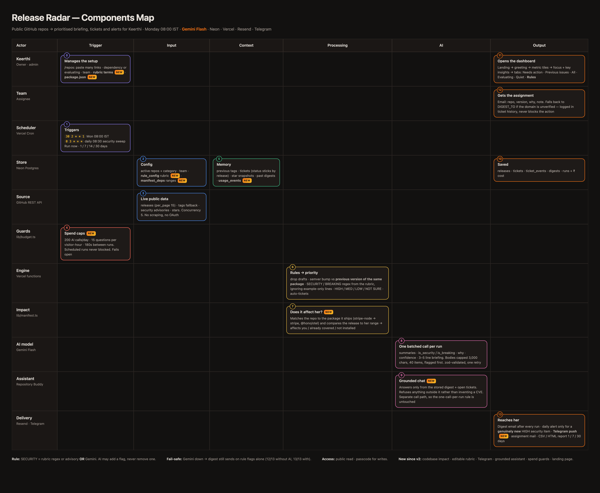

# Release Radar

Keerthi watches 20+ public GitHub repos — payment gateways, auth libraries, banking APIs.
GitHub Watch is a firehose, so last quarter a security patch sat unread for **11 days**.
Release Radar reads only *releases*, puts security fixes and breaking changes at the top, and mails her a 5-minute digest every Monday 08:00 IST.

- **Live URL:** **https://release-radar-radhi2.vercel.app**
- **Repo:** https://github.com/radhikanarayan-mesa23/release-radar
- **Components map:** [`components_map.png`](./components_map.png)



Public read: the dashboard, every tab, `/quality` and `/status` are open to anyone.
Admin actions (run, add repos, assign, export) need the passcode at `/login`.

## What it looks like

The dashboard answers one question — *what do I do today?* Metric tiles segment the
live work queue and each one filters the list; "Your focus today" carries the AI
briefing grouped HIGH → MEDIUM → LOW; "Start here" links the top HIGH items; and the
bell confirms the Monday run already happened before she opened the tab.

## Pages

| Page | Who | What |
|---|---|---|
| `/` | public read | Briefing → priority strip → tabs: **Needs action · Fixed · All releases · Evaluating · Quiet**. Sidebar: Run now, download report, past digests, next Monday run. |
| `/repos` | public read, admin write | Dependencies / Evaluating, bulk add (paste many links at once), category toggle, pause, delete, Team panel. |
| `/report` | admin | HTML (print → PDF) or CSV for the last 24 h / 7 d / 30 d. Built from stored rows — no AI call. |
| `/quality` | public | `lib/rules.ts` run live over 13 fixtures vs the last stored Gemini eval: rules-only score, rules+Gemini, security missed, caught by Gemini only. |
| `/status` | public | Last run, next Monday run, active repos, ₹ this month, runs table, env set/missing (names only), repo errors. |
| `/login` | — | Passcode → httpOnly cookie. |

## Design decisions

- **Official REST API, never scraping.** `api.github.com` only, read-only token, no OAuth and no GitHub App — so any public repo can be added with zero setup on the repo's side.
- **Rules first, AI second.** `lib/rules.ts` is pure and tested. Final flags = **rule flags OR Gemini flags**: the model may *add* a flag it spots, never argue one away. A model outage cannot hide a CVE.
- **Example-only changes are not security.** Lines about `examples/`, docs, tests, playgrounds or devDependencies are dropped before the security regex runs, so `chore(examples): …fix RCE…` stays LOW (fixture F13). Without this, a quarter of dependency-bot releases would scream red.
- **One batched Gemini call per run.** All releases in a single JSON-mode request, bodies truncated to 3,000 chars, 40 items max, flagged first. One call per run keeps cost at a few paise and latency inside the cron window.
- **Fail-safe.** If Gemini errors or returns a bad shape (one retry), the digest is still saved and still mailed, using rule flags plus the first lines of each release note, under the banner *"AI summary unavailable: flags from rules only"*.
- **Tickets are keyed by `release_id` (repo + tag).** Marking something Fixed survives every later run — the Fixed tab is the source of truth, not the digest payload.
- **A daily security sweep closes the 11-day gap.** The weekly digest is the routine; the 08:30 IST daily run emails *only* when a new HIGH security item appears.
- **Public read, admin write.** Anyone can open the digest, tabs, `/quality` and `/status`; the passcode gates runs, repo edits, assignment and reports. No secret ever reaches the client.

## Setup (6 steps)

1. `npm install`
2. Create a Neon project (Vercel → Storage → Create → Neon adds `DATABASE_URL` for you).
3. In the Neon SQL editor run `db/schema.sql`, then `db/seed.sql`.
4. `cp .env.example .env` and fill it in (table below).
5. `npm run test:rules` (expects 12/13 rules-only), then `npm run dry-run -- 30` for the first live digest.
6. Deploy to Vercel, set the same env vars plus `APP_URL`, and the crons in `vercel.json` start running.

## Environment

| Var | Why |
|---|---|
| `DATABASE_URL` | Neon pooled connection string |
| `GITHUB_TOKEN` | fine-grained, public repositories, read-only |
| `GEMINI_API_KEY` / `GEMINI_MODEL` | Gemini Flash (exam rule: Gemini only) |
| `RESEND_API_KEY` / `EMAIL_FROM` / `DIGEST_TO` | digest, alert and assignment mail |
| `ADMIN_PASSCODE` | unlocks runs, repo edits, assignment, reports |
| `CRON_SECRET` | Bearer token Vercel Cron sends to `/api/cron/*` |
| `APP_URL` | links inside emails |
| `COST_GEMINI_INR_PER_1K_*` | ₹ shown on `/status` and in each digest |

## How Keerthi uses it

**Add repos:** `/repos` → paste a whole block into the textarea —
`https://github.com/stripe/stripe-node  honojs/hono, plaid/plaid-node` — separated by spaces, commas or new lines.
Each is validated live against the GitHub API and saved under its canonical name; the result reads
*"Added 3 · already tracked 1 · not found 1"*. Toggle any repo between **dependency** and **evaluating** from its row.

**Assign work:** on any flagged card pick a teammate, set **Open / In progress / Fixed / Dismissed**, add a note.
The assignee gets an email. Fixed moves the item to the **Fixed** tab and it stays there through later runs.
Until a domain is verified in Resend, assignment mail is forwarded to `DIGEST_TO` marked *"(intended for …)"* and the
fallback is logged in the ticket history — an email failure never blocks the action.

## Scripts

```
npm run test:rules        # 13 fixtures, no network, no AI
npm run dry-run -- 30     # live 30-day run against Neon + GitHub + Gemini
npm run build
```
